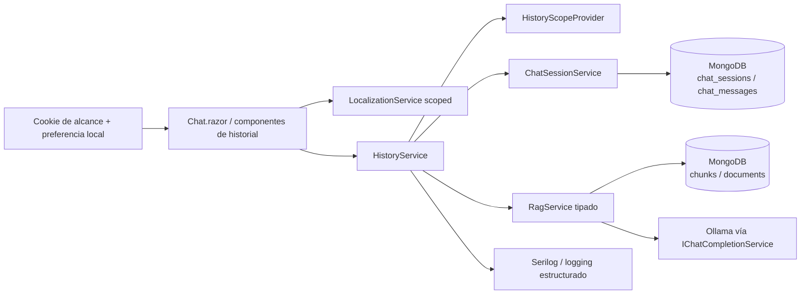
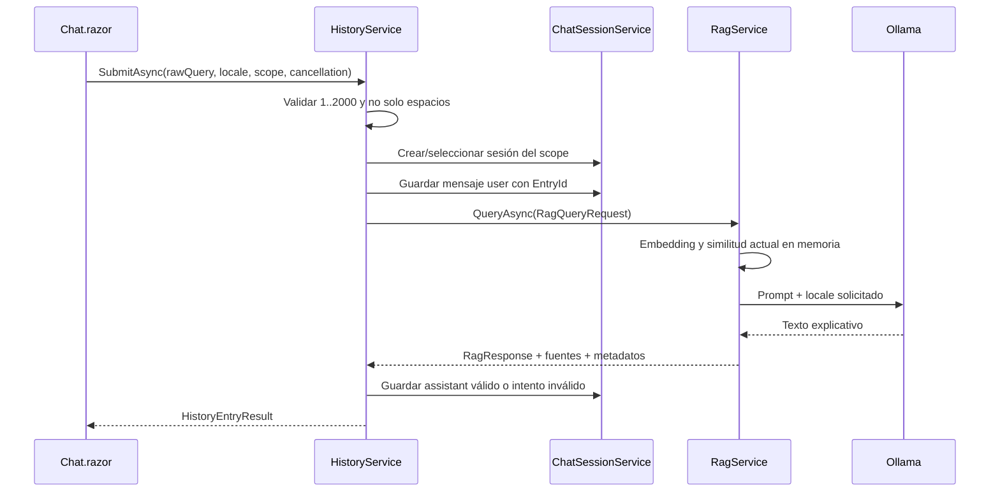

# Diseño de historial y localización RAG

> **Estado:** diseño histórico de una fase consolidada. Queda supersedido por las especificaciones separadas de las fases 3, 4, 5 y 6. Consulta `.kiro/specs/README.md` antes de implementar.

## Estado y alcance

Este diseño corresponde a `rag-phase-3-history-localization` y se basa en los requisitos aprobados de la fase 3 y en la arquitectura comprobada de la fase 2. No implementa código ni descompone el trabajo en tareas.

La primera versión conectará la página `/chat` con persistencia de historial en MongoDB, selección de idioma `es`/`en`/`pt` y respuestas RAG con idioma explícito. No cambia la ingesta documental, el cálculo actual de embeddings ni la estrategia de similitud en memoria de `RagService`, salvo la información tipada que debe devolver para guardar trazabilidad.

La ruta activa de la fase 2 es `Chat.razor -> RagService -> chunks/documents -> Ollama`. `EnhancedRagService` y `RagOrchestrator` están registrados, pero no son llamados por `/chat`; este diseño no los convierte en la ruta principal de forma implícita.

## Decisiones D1-D8

| Decisión | Elección para la primera versión | Justificación y límites |
|---|---|---|
| **D1. Almacenamiento** | Persistencia de servidor en MongoDB mediante `ChatSessionService` y las colecciones `chat_sessions`/`chat_messages`. | Reutiliza la infraestructura ya registrada en `Program.cs`, permite exportación y retención centralizadas y evita que el historial dependa de la capacidad de `localStorage`. El navegador conserva solo la preferencia de idioma y un identificador opaco de alcance. No se adopta modalidad híbrida en esta versión. |
| **D2. Identidad y privacidad** | Historial anónimo por navegador, con un `HistoryScopeId` aleatorio emitido por el servidor y conservado en una cookie protegida. | No existe autenticación verificable en la fase 2, por lo que `UserId` no puede autorizar acceso. El alcance por navegador limita la exposición accidental entre navegadores, pero no es una frontera de seguridad frente a quien copie la cookie. La UI no presentará `UserId` como propietario ni aceptará un `userId` enviado por el cliente como autorización. La autenticación por persona queda fuera de esta versión. |
| **D3. Selección de idioma** | Selector manual con exactamente `es`, `en` y `pt`; valor inicial `es`; preferencia local y estado de circuito. | Es determinista, no depende de detectar consultas cortas o mezcladas y funciona en `/chat`, `/documents` y `/statistics` sin reiniciar la aplicación. La detección automática del navegador no reemplaza al selector. |
| **D4. Alcance de traducción** | Traducir la interfaz y el texto explicativo generado; conservar identificadores técnicos, títulos originales y citas de fuentes sin modificar. | Preserva la trazabilidad documental. No se traducen extractos ni nombres propios, y la aplicación no interpreta el texto formateado para reconstruir metadatos. |
| **D5. Retención** | Sesiones inactivas durante 30 días como valor inicial, configurable entre la política operativa y la configuración de `ChatSessionService`; primero se marcan elegibles y una limpieza posterior elimina. | Alinea el diseño con `MaxInactiveAge = 30 días` y la limpieza existente, pero evita que la elegibilidad por sí sola borre una sesión. Las sesiones archivadas no se eliminan por la limpieza automática. |
| **D6. Sesiones** | Una sesión continua por alcance de navegador hasta que la persona elige “Nueva consulta”; si no hay sesión seleccionada, el primer envío crea una sesión. | Conserva el comportamiento de la UI actual y hace explícito el inicio de una sesión nueva. La navegación entre rutas no crea sesiones ni invoca RAG. |
| **D7. Respuestas fallidas** | Guardar el intento fallido como una entrada inválida con la consulta original, estado y motivo seguro; no presentarlo como respuesta completa ni reutilizable. | Cumple la trazabilidad de errores y evita perder la consulta. El detalle técnico queda en logs estructurados, no en la interfaz ni en la respuesta almacenada como si fuera válida. |
| **D8. Modelo lingüístico** | Mantener el único modelo Ollama configurado por `Ollama:Model` y añadir el `Locale` al contrato y al prompt del servicio RAG. | Es el cambio mínimo compatible con la integración `IChatCompletionService` actual. Los tres locales se consideran soportados por instrucciones de prompt; si el modelo o configuración no puede cumplir el locale, se devuelve una limitación localizada y no se etiqueta la respuesta como traducida. Un modelo distinto por idioma queda fuera. |

## Overview

La fase 3 introduce una capa de aplicación `HistoryService` entre `Chat.razor`, el servicio RAG y `ChatSessionService`.

El flujo normal será:

1. `Chat.razor` valida longitud y contenido no vacío con el idioma activo.
2. `HistoryService` resuelve el `HistoryScopeId`, crea o selecciona una sesión y registra el mensaje de usuario con un `EntryId`.
3. `HistoryService` llama a `RagService` mediante un contrato tipado que incluye la consulta original, el locale de respuesta y un `CancellationToken`.
4. `RagService` recupera chunks con la lógica actual, llama a Ollama con instrucciones del locale y devuelve texto explicativo, fuentes estructuradas y metadatos del modelo.
5. `HistoryService` guarda una respuesta válida o una entrada inválida con estado y motivo seguro. La UI actualiza el estado sin volver a consultar al modelo.
6. Las cargas, búsquedas, exportaciones, archivados y eliminaciones pasan por el alcance de privacidad y por el mismo servicio de aplicación.

El diseño separa cuatro responsabilidades:

- **Transporte/UI:** eventos Blazor, foco, renderizado, estado de carga y descarga de exportaciones.
- **Aplicación:** validación, sesiones, reutilización, límites, cancelación, autorización de alcance y coordinación de errores.
- **RAG:** recuperación documental y generación en el locale solicitado.
- **Persistencia/localización:** MongoDB, cookie de alcance, preferencia local y recursos de interfaz.

### Compatibilidad verificada con fase 2

- `BlazorApp/Components/Pages/Chat.razor` inyecta hoy `RagService` directamente y muestra una sola respuesta. El diseño sustituye esa dependencia directa por `HistoryService`, pero mantiene la ruta `/chat` y el límite de 2000 caracteres.
- `BlazorApp/Services/RagService.cs` hoy expone `QueryAsync(string)` y convierte fuentes en Markdown. El diseño añade una operación tipada que devuelve fuentes y deja un adaptador de compatibilidad para el contrato de texto durante la transición.
- `ChatSessionService` ya usa las colecciones `chat_sessions` y `chat_messages`, ordena mensajes por `Timestamp`, exporta JSON/Markdown y tiene limpieza automática. La nueva capa reutiliza esas capacidades, pero no confía en `ChatSession.Messages` para búsquedas porque la implementación persiste mensajes en una colección separada.
- `ChatSession` ya contiene `UserId`, `LastActive` y `SessionMetadata.Language`. Se conserva `Language` como idioma de interfaz de la sesión; se añade un alcance anónimo explícito y el idioma de cada respuesta en la entrada/mensaje para no confundir preferencias.
- `Program.cs` ya registra MongoDB, `RagService`, `ChatSessionService`, Serilog y los servicios de Ollama como singletons. El estado de idioma de UI será scoped por circuito y no se guardará en un singleton.

## Architecture



### Flujo de consulta



### Alcance de privacidad

`HistoryScopeProvider` obtiene un identificador aleatorio generado por el servidor. El identificador se entrega mediante cookie protegida, no se acepta desde parámetros de sesión ni desde `UserId`, y se añade como filtro obligatorio a cada operación de lectura o mutación. Las sesiones creadas antes de la fase 3, sin alcance, no se exponen en el historial anónimo nuevo hasta que exista una migración explícita; esto evita asignar datos antiguos al navegador equivocado.

La cookie es un identificador de aislamiento operativo, no una autenticación. El diseño deja un punto de extensión para reemplazar el proveedor por una identidad autenticada sin cambiar `HistoryService`.

### Transacciones y eliminación

La eliminación de una sesión y sus mensajes debe ser una única operación lógica. La implementación objetivo usa una transacción MongoDB sobre las dos colecciones y confirma que el despliegue soporta transacciones antes de habilitar eliminación. Si la capacidad no está disponible, la operación se rechaza antes de mutar datos y la UI muestra indisponibilidad; no se simula atomicidad con dos borrados independientes.

## Components and Interfaces

### `HistoryService`

Fachada de aplicación que coordina el caso de uso y es la única dependencia de la UI para el historial. Sus operaciones conceptuales son:

- `SubmitAsync(HistorySubmission, CancellationToken)`: valida, crea/selecciona sesión, guarda consulta, invoca RAG y guarda resultado.
- `ListSessionsAsync(HistoryScope, HistoryListRequest, CancellationToken)`: lista activas o archivadas, busca por título/consulta/respuesta y pagina entre 1 y 50.
- `LoadSessionAsync(sessionId, scope, CancellationToken)`: verifica alcance y devuelve mensajes ascendentes por `Timestamp`.
- `ReuseQueryAsync(sessionId, entryId, scope, CancellationToken)`: devuelve solo el texto original al editor; no llama a RAG.
- `ArchiveAsync`, `RestoreAsync`, `DeleteAsync`: aplican alcance y estados.
- `ExportAsync(sessionId, format, scope, CancellationToken)`: produce JSON o Markdown con datos originales, idioma y fuentes.
- `GetSourceAsync`: resuelve metadatos actuales sin borrar la cita histórica cuando el documento ya no existe.

El resultado de `SubmitAsync` distingue `Completed`, `Invalid`, `Rejected`, `Cancelled`, `TimedOut` y `Unavailable`. Un estado distinto de `Completed` nunca se renderiza como respuesta válida.

### `RagService` tipado

Se conserva la recuperación actual: embedding de la consulta, lectura de `chunks`, similitud coseno en memoria, selección de resultados, contexto documental y llamada al `IChatCompletionService`. Se añade un contrato equivalente a:

```text
RagQueryRequest
  Query: texto original
  ResponseLocale: es | en | pt
  MaxResults: configuración actual
  CorrelationId

RagResponse
  Status: Completed | NoContext | UnsupportedLocale | Failed
  AnswerText
  ResponseLocale
  Sources: SourceReference[]
  ModelMetadata
  FailureCode
  FailureMessageForUi
```

`FormatResponseWithSources` deja de ser la única fuente de verdad. El texto Markdown puede seguir mostrando las fuentes, pero la persistencia recibe `SourceReference[]` directamente. `QueryAsync(string)` se mantiene temporalmente como adaptador que usa `es` y devuelve solo texto para consumidores de fase 2 que aún no migren.

El prompt añade una instrucción explícita para redactar el texto explicativo en `ResponseLocale`, conservar identificadores técnicos, nombres de documentos y citas sin traducir, y no inventar información ausente del contexto.

### `ChatSessionService` y repositorios

`ChatSessionService` seguirá siendo el servicio MongoDB existente, pero la interfaz de aplicación debe imponer:

- filtro por `PrivacyScopeId` en todas las consultas;
- validación de `pageSize` entre 1 y 50;
- límite de mensajes antes de insertar;
- búsquedas que consulten `chat_messages`, no solo el arreglo `Messages` de `ChatSession`;
- estado explícito `active`, `archived` o `eligible-for-cleanup`, con lectura compatible del `CustomProperties["status"]` legacy;
- transacción para eliminar sesión y mensajes;
- propagación de `CancellationToken` y timeout configurado.

No se usa `UserId` como prueba de autorización. Puede conservarse como dato descriptivo si una futura autenticación lo proporciona.

### `LocalizationService`

Servicio scoped que mantiene el locale activo, normaliza solo `es`, `en` y `pt`, guarda la preferencia local y expone `Get(key, args)`. Usa recursos compilados con `es` como fallback. Al faltar una clave registra el nombre de la clave y devuelve el valor español; nunca devuelve una plantilla con marcadores sin resolver.

La preferencia de idioma se guarda en el navegador. Al cambiarla, el servicio notifica a los componentes y `Chat.razor`, `/documents` y `/statistics` vuelven a renderizar sin reiniciar. Al habilitar persistencia, el locale se copia en `SessionMetadata.Language` de la sesión activa.

### `HistoryScopeProvider`

Servicio scoped que obtiene el alcance de la cookie protegida, solicita su creación al servidor cuando falta y lo incluye en los casos de uso. No expone un método que acepte un `UserId` como sustituto del alcance.

### Componentes de UI

- `Chat.razor`: editor, selector de idioma, lista de sesiones, estado de carga/error/vacío, mensajes ordenados y acciones de reutilizar, archivar, restaurar, exportar y eliminar.
- `HistoryPanel`: búsqueda, paginación, estados de fuente y sesión no disponible.
- `ChatMessage`: diferencia visualmente consulta, respuesta válida, resultado guardado y entrada inválida.
- `SourceReference`: muestra nombre almacenado y ubicación; si falta el documento actual, conserva la cita y muestra que no se puede abrir.
- `LanguageSelector`: muestra exactamente los tres valores soportados.

La UI no vuelve a llamar a RAG al cargar una sesión. Reutilizar solo llena el editor y requiere un envío confirmado.

## Data Models

### Extensiones compatibles de sesión y mensaje

`ChatSession` conserva `Id`, `Title`, `CreatedDate`, `LastActive`, `Metadata.Language`, `Messages` y `UserId`. Se añaden o proyectan los siguientes datos:

```text
ChatSession
  PrivacyScopeId: string              // alcance anónimo emitido por servidor
  Status: active | archived | eligible-for-cleanup
  Metadata.Language: es | en | pt      // preferencia de interfaz de la sesión
```

`ChatMessage` conserva `Role`, `Content`, `Timestamp`, `SessionId`, `SourceDocuments` y `Metadata`. Cada intento añade:

```text
HistoryMessageMetadata
  EntryId: string                     // une consulta y respuesta/intento
  ResponseLocale: es | en | pt | null
  EntryStatus: pending | completed | invalid | cancelled | timed-out | failed
  IsReusable: bool
  FailureCode: string | null
  FailureReason: string | null        // mensaje seguro, sin secretos
  Sources: SourceReference[]
  ModelMetadata: dictionary           // modelo, tokens, contexto y similares
```

La consulta se almacena en `Content` exactamente como se envió después de pasar validación. La respuesta assistant válida se almacena en otro mensaje con el mismo `EntryId`; un fallo conserva la consulta y un mensaje de estado no reutilizable.

### `SourceReference`

```text
SourceReference
  DocumentId: string
  StoredDocumentName: string
  Location: string                    // página, sección o posición cuando exista
  RetrievedAtUtc: DateTime?
  Relevance: double?
  Quote: string?
  IsCurrentlyAvailable: bool          // calculado al abrir, no sustituye datos históricos
```

`SourceDocuments` se conserva para compatibilidad y contiene identificadores. `SourceReference` es la representación completa para historial y exportación. Los títulos originales y las citas se guardan sin traducir.

### Configuración

```text
HistoryOptions
  MaxQueryLength: 2000                // válido: 1..2000
  MaxMessagesPerSession: 10000        // válido: 1..10000
  DefaultPageSize: 20                 // válido: 1..50
  OperationTimeoutSeconds: 30         // válido: 1..120
  RetentionDays: 30                   // primera versión
  CleanupIntervalMinutes: 60
  SupportedLocales: [es, en, pt]
```

La configuración se valida al iniciar. Un valor fuera de rango impide el arranque de la funcionalidad de historial y registra el motivo, en lugar de degradar silenciosamente a un límite distinto.

### Persistencia e índices

- `chat_sessions`: índice compuesto `{ PrivacyScopeId: 1, Status: 1, LastActive: -1 }` para listas; índice adicional para `CreatedDate` si lo requieren estadísticas.
- `chat_messages`: índice `{ SessionId: 1, Timestamp: 1 }`, ya previsto por el servicio existente.
- Búsqueda de texto: consulta de título y mensajes mediante una agregación o una proyección de texto normalizada. La consulta se escapa como literal para evitar que un texto del usuario se interprete como expresión regular.
- TTL: no se usa un TTL directo como única política porque MongoDB eliminaría documentos sin permitir el estado `eligible-for-cleanup` ni coordinar mensajes. La limpieza de `HistoryService` marca elegibles y elimina mediante la operación transaccional.

## Aplicabilidad de pruebas basadas en propiedades

La funcionalidad es mixta. La UI, MongoDB, Ollama, cookies y operaciones de archivo se validan con pruebas de ejemplo, integración, contrato y smoke; no se someten a 100 llamadas externas. Sí existe una capa pura de lógica de historial con variación amplia de entradas: normalización de locale, validación de consultas y límites, filtrado de búsqueda, transiciones de estado, orden cronológico y serialización de exportaciones. Para esa capa se usarán propiedades basadas en `FsCheck` para .NET, con un mínimo de 100 iteraciones por propiedad. Cada prueba llevará el comentario `Feature: rag-phase-3-history-localization, Property N: ...`.

La sección de propiedades se escribirá después de analizar cada criterio de aceptación y eliminar propiedades redundantes. Los criterios de UI estética, disponibilidad externa y configuración se mantendrán como ejemplos, integración o smoke.

## Correctness Properties

Una propiedad es una característica o comportamiento que debe mantenerse en todas las ejecuciones válidas del sistema. Las propiedades conectan los requisitos escritos con garantías automatizables. En esta sección solo se incluyen invariantes de la capa pura de aplicación; las dependencias externas y los detalles visuales se cubren en la estrategia de pruebas.

### Reflexión sobre redundancia

El pretrabajo identificó varios criterios relacionados. Se consolidaron la validación de entrada de 1.4 con el límite previo a RAG de 9.1; la preservación de consulta y locale de 7.6 con el mapeo de respuesta de 1.2; y la normalización de locale inicial/inválido de 5.4 y 5.5. La ordenación de mensajes, paginación, búsqueda, estados de archivado/restauración, exportación, retención, fuentes y metadatos conservan valor de validación diferente y no se combinan. Los criterios de UI, navegación, recursos completos, disponibilidad de MongoDB/Ollama y transacciones quedan como ejemplos, integración o smoke tests.

### Property 1: Validación bloquea entradas fuera de límites

*For any* consulta cuya longitud sea menor que 1, mayor que `MaxQueryLength` o cuyo contenido sea solo espacio en blanco, la validación SHALL rechazarla, conservar el texto introducido, no cambiar la sesión y no invocar a `RagService`; *for any* consulta válida entre 1 y `MaxQueryLength`, la validación SHALL permitir el flujo sin alterar el texto original.

**Validates: Requirements 1.4, 9.1**

### Property 2: Locale se normaliza al conjunto soportado

*For any* preferencia ausente, nula o con código distinto de `es`, `en` y `pt`, la normalización SHALL producir `es` y reemplazar la preferencia inválida; *for any* locale soportado, la normalización SHALL conservar exactamente ese código.

**Validates: Requirements 5.4, 5.5**

### Property 3: Una consulta válida tiene una sesión y una entrada correlacionada

*For any* consulta válida y estado inicial con o sin sesión seleccionada, el flujo SHALL tener una sesión activa antes de guardar el mensaje de usuario, conservar la consulta original y asignar un `EntryId` que permita asociar su resultado posterior.

**Validates: Requirements 1.1, 7.6**

### Property 4: Una respuesta válida conserva idioma, fecha y fuentes

*For any* `RagResponse` completado, locale soportado y lista de `SourceReference`, el mapeo a historial SHALL guardar el texto de respuesta, el locale exacto, un timestamp UTC y todas las referencias proporcionadas sin omitir ninguna.

**Validates: Requirements 1.2, 7.6, 8.1**

### Property 5: Los fallos nunca se presentan como respuestas reutilizables

*For any* respuesta parcial, fallo, cancelación o timeout, el flujo SHALL crear o conservar una entrada con estado no válido, motivo seguro y `IsReusable = false`, y SHALL impedir que el estado se presente como respuesta completa.

**Validates: Requirements 1.3, 4.6, 9.6**

### Property 6: La presentación cronológica es estable

*For any* conjunto finito de mensajes con timestamps, la proyección de una sesión SHALL devolverlos en orden ascendente de `Timestamp` y SHALL conservar cada mensaje exactamente una vez, con una categoría visual determinada por su rol y estado.

**Validates: Requirements 1.5**

### Property 7: La lista respeta orden y límites de paginación

*For any* conjunto de sesiones y parámetros de página, el resultado SHALL estar ordenado por `LastActive` descendente, SHALL devolver como máximo 50 sesiones y SHALL normalizar cualquier tamaño solicitado fuera de 1..50 antes de ejecutar la consulta.

**Validates: Requirements 2.4**

### Property 8: La búsqueda encuentra coincidencias en todos los campos admitidos

*For any* texto de búsqueda no vacío y conjunto de sesiones/mensajes, una sesión devuelta SHALL contener el texto en título, consulta o respuesta sin distinguir mayúsculas de minúsculas, y una sesión sin coincidencia SHALL quedar excluida; el texto se tratará como literal y no como expresión regular.

**Validates: Requirements 3.1**

### Property 9: Las fuentes conservan su representación documental

*For any* `SourceReference` con nombre, ubicación, cita y metadatos opcionales, la proyección de historial y UI SHALL conservar el nombre almacenado y todos los metadatos presentes, y SHALL omitir únicamente campos que realmente no fueron proporcionados; ningún locale SHALL modificar título original, identificador o cita.

**Validates: Requirements 3.5, 7.4, 8.1**

### Property 10: Archivar excluye sin perder contenido

*For any* sesión activa y conjunto de mensajes, archivarla SHALL cambiar únicamente su estado de disponibilidad a `archived`, excluirla de la lista activa y conservar sin cambios sus mensajes, timestamps y referencias.

**Validates: Requirements 4.1**

### Property 11: Restaurar es reversible para el contenido

*For any* sesión archivada, restaurarla SHALL devolverla a la lista activa y SHALL conservar exactamente el título, mensajes, referencias y fechas que tenía antes de restaurarse.

**Validates: Requirements 4.2**

### Property 12: La exportación preserva el historial

*For any* sesión exportable, el JSON generado SHALL ser válido y ambos formatos SHALL incluir consulta, respuesta, fechas, locale, estados y todas las fuentes disponibles; la serialización SHALL omitir secretos de infraestructura y no SHALL sustituir el texto original por una traducción.

**Validates: Requirements 4.4, 7.6, 8.1**

### Property 13: La retención solo marca sesiones elegibles

*For any* sesión, fecha actual, política de retención y estado, una sesión solo SHALL pasar a `eligible-for-cleanup` cuando `LastActive` sea anterior al cutoff y la política esté habilitada; la evaluación SHALL no eliminarla ni marcar como elegible una sesión reciente o archivada.

**Validates: Requirements 4.5**

### Property 14: El fallback de localización es español y deja trazabilidad

*For any* clave ausente en `en` o `pt`, `LocalizationService` SHALL devolver el valor no vacío de `es`, SHALL registrar la clave ausente una vez por resolución y SHALL no devolver una plantilla sin resolver.

**Validates: Requirements 6.3, 6.5**

### Property 15: Los valores dinámicos quedan formateados

*For any* clave localizada con argumentos válidos de fecha, número o texto, la resolución SHALL producir un texto sin marcadores de formato pendientes y SHALL aplicar la cultura del locale seleccionado a los valores formateables.

**Validates: Requirements 6.4**

### Property 16: La solicitud RAG conserva locale y consulta

*For any* consulta válida y locale soportado, la solicitud que `HistoryService` envíe a `RagService` SHALL contener exactamente el texto original y el código exacto del locale, sin usar la respuesta guardada como entrada ni traducir la consulta.

**Validates: Requirements 7.1, 7.6, 8.3**

### Property 17: Los metadatos de modelo y contexto se preservan

*For any* diccionario de metadatos proporcionado por RAG, el `HistoryEntry` SHALL conservar todas sus claves y valores, aunque la UI no los muestre de forma predeterminada.

**Validates: Requirements 8.6**

### Property 18: El límite de mensajes protege el contenido previo

*For any* sesión con `n` mensajes y límite configurado `M`, cuando `n < M` el siguiente mensaje válido SHALL poder aceptarse, y cuando `n >= M` el intento SHALL rechazarse sin cambiar los mensajes ya almacenados ni informar éxito.

**Validates: Requirements 9.2**

## Error Handling

### Validación y estados de dominio

- La entrada vacía, solo espacios o sobre el límite se rechaza antes de crear una sesión o llamar a RAG. Se conserva el texto del editor y se usa el mensaje localizado correspondiente.
- Los locales se normalizan al inicio. Un código inválido nunca llega a Ollama ni se guarda como preferencia.
- Alcanzar el máximo de mensajes devuelve un resultado `Rejected` y mantiene los mensajes existentes.
- Una consulta reutilizada no se considera enviada hasta la confirmación explícita.

### MongoDB y persistencia

- Timeout, cancelación o indisponibilidad de MongoDB produce `Unavailable`, `Cancelled` o `TimedOut` sin informar éxito.
- Una carga fuera del alcance devuelve `NotAvailable` y cero mensajes. El log registra el rechazo sin texto de consulta ni respuesta.
- El borrado requiere capacidad transaccional. Si el preflight no la confirma, se rechaza sin mutación. Si falla la transacción, la aplicación devuelve error y la sesión y sus mensajes permanecen.
- La exportación se construye a partir de una lectura completa; si falla, no modifica la sesión ni marca la exportación como completada.
- La limpieza automática primero marca elegibilidad y solo ejecuta una eliminación validada por la misma operación transaccional. Las sesiones archivadas quedan excluidas.

### Ollama y RAG

- Una respuesta parcial, error del embedding, falta de chunks, fallo del modelo o cancelación se guarda como intento inválido con código seguro y no reutilizable.
- El error técnico completo se conserva en logging estructurado. La UI muestra un mensaje localizado sin endpoint, cadena de conexión, excepción completa ni credenciales.
- Si el modelo no puede producir el locale solicitado, `RagResponse.Status` es `UnsupportedLocale`, la interfaz informa la limitación en el idioma de interfaz y la consulta original permanece sin cambios.
- La reutilización siempre crea una petición de recuperación nueva contra el índice actual; la respuesta guardada solo aporta la consulta y contexto visual histórico.

### Localización y UI

- Si falta una clave, se usa el recurso español y se registra la clave. Si falta también el fallback español, se usa un texto estable de emergencia definido por tipo de error, nunca el detalle de infraestructura.
- Un fallo de persistencia no bloquea iniciar una consulta nueva si el editor y el estado local de la UI siguen disponibles. La interfaz indica que el historial no está disponible.
- Si una fuente histórica ya no existe en `documents`, se muestran sus datos guardados y se deshabilita solo la acción de abrir el documento actual.

### Observabilidad

Cada operación de historial abre un scope de correlación y registra, sin contenido completo:

- tipo de operación;
- `SessionId` cuando esté disponible;
- duración en milisegundos;
- resultado `éxito`, `rechazo`, `fallo`, `cancelado`, `agotado` o `indisponible`;
- `CorrelationId`;
- conteos y códigos de error no sensibles.

La implementación reutiliza Serilog, `CorrelationId`, los middlewares de logging/performance y los umbrales documentados en `BlazorApp/LOGGING_IMPLEMENTATION.md`. Las consultas y respuestas completas no se escriben por defecto, y los logs de autorización rechazada tampoco incluyen el contenido de la sesión.

## Testing Strategy

### Unidad y propiedades

La suite `BlazorAppTests` seguirá usando xUnit y Moq para ejemplos y dobles. Se añadirá `FsCheck` o `FsCheck.Xunit` para las propiedades de este documento; no se implementará un generador propio de propiedades. Cada propiedad tendrá una única prueba basada en propiedades, con mínimo 100 casos y una etiqueta en comentario con este formato:

```text
Feature: rag-phase-3-history-localization, Property N: [texto de la propiedad]
```

Las pruebas unitarias normales cubrirán:

- límites exactos 1, 2000 y 2001 caracteres;
- Unicode, espacios significativos y consultas mezcladas;
- los tres locales, preferencia ausente e inválida;
- estados `completed`, `invalid`, `cancelled`, `timed-out` y `failed`;
- exportación JSON válida y Markdown con fuentes opcionales;
- fallbacks y claves ausentes;
- protección contra regex no literal en búsqueda;
- cancelación y propagación de timeout con dobles de servicio.

### Componentes Blazor

Las pruebas de componente o navegador verificarán:

- selector exactamente `es`, `en`, `pt`;
- actualización de textos sin reinicio y conservación entre `/chat`, `/documents` y `/statistics`;
- estados de carga, vacío, validación, error, respuesta guardada y respuesta inválida;
- carga de una sesión sin llamadas a RAG;
- reutilización que llena el editor sin enviar y envío posterior que crea entrada nueva;
- visualización de roles, fuentes, timestamp y documento no disponible.

La estética sutil del foco no se convierte en una propiedad PBT; se valida por prueba visual o revisión de componente.

### Integración MongoDB

Con MongoDB de prueba y capacidad transaccional se comprobará:

- persistencia separada en `chat_sessions` y `chat_messages`;
- filtro obligatorio por `PrivacyScopeId`;
- búsqueda por título, consulta y respuesta;
- orden y paginación;
- archivado/restauración;
- eliminación transaccional y rollback ante fallo;
- límite de mensajes, índices y limpieza por retención;
- exportaciones con fuentes y metadatos.

Las pruebas se ejecutarán con datos de prueba aislados y no con las copias de `backups/`. Una prueba de integración que no pueda conectar con MongoDB se marca `NotRunnableExternalDependency`, no como fallo de comportamiento.

### Integración Ollama/RAG

Con Ollama disponible se verificará al menos una consulta por locale soportado, la presencia del locale en la solicitud y la devolución de fuentes tipadas. Se separará la comprobación del contrato de la calidad lingüística del modelo: el test no debe afirmar una traducción exacta de texto generativo, sino idioma solicitado, preservación de identificadores/citas y estado correcto.

Si Ollama no está disponible, el preflight identifica la dependencia y excluye la prueba de comportamiento, conforme al requisito 10.6. Se usará un fake de `IChatCompletionService` para la mayoría de pruebas de `HistoryService` y `RagService`.

### End-to-end y smoke

La suite E2E cubrirá la ruta `/chat`: consulta, recuperación del historial, reutilización, segunda entrada, eliminación y exportación. También comprobará estados visibles en `en` y `pt`. Las pruebas de arranque validarán recursos de los tres locales, configuración de límites, cookie de alcance, índices y capacidad transaccional requerida.

### Fuentes de diseño y hallazgos de investigación

La investigación se realizó contra el repositorio local, que es la fuente principal para compatibilidad:

- `BlazorApp/Components/Pages/Chat.razor`: flujo activo de una consulta, límite de 2000, Enter/Shift+Enter y dependencia directa de `RagService`.
- `BlazorApp/Services/RagService.cs`: embeddings, lectura de chunks, similitud coseno en memoria, prompt actualmente en español, respuesta textual y fuentes formateadas.
- `BlazorApp/Services/ChatSessionService.cs`: colecciones separadas, ordenación, búsqueda, exportación, limpieza de 30 días e índices actuales; también muestra que la búsqueda por `Messages` no basta cuando los mensajes viven en `chat_messages`.
- `BlazorApp/Models/ChatSession.cs` y `BlazorApp/Models/ChatMessage.cs`: campos disponibles, `SessionMetadata.Language`, `SourceDocuments` y metadatos del modelo.
- `BlazorApp/Program.cs` y `BlazorApp/appsettings.json`: registro singleton de MongoDB, Ollama, `RagService` y `ChatSessionService`, y los valores `llama3.2`/`nomic-embed-text`.
- `BlazorAppTests/BlazorAppTests.csproj`: xUnit, Moq y referencia al proyecto principal; no existe actualmente una biblioteca PBT.
- `BlazorApp/LOGGING_IMPLEMENTATION.md`: Serilog, correlación, logging de operaciones y umbrales de rendimiento.

Estos hallazgos justifican mantener la ruta RAG activa, introducir contratos tipados para no parsear Markdown, añadir una capa de historial con alcance explícito y limitar PBT a transformaciones y reglas puras.
