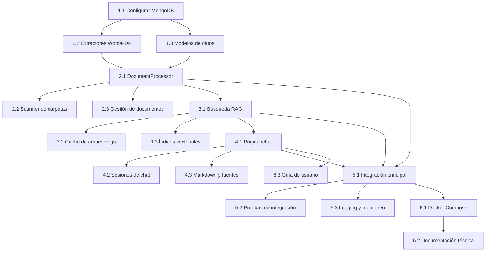

# Plan de implementación de RAG Phase 2

**Última sincronización:** 2026-11-13

## Criterio de estado

- **[x]** Implementación comprobable en el código.
- **[-]** Implementación parcial, no integrada o sin evidencia suficiente de uno o más criterios.
- **[ ]** Pendiente o sin implementación comprobable.

Los estados reflejan el repositorio actual. La existencia de archivos, timestamps de `tasks.meta.json` o artefactos de build no se considera por sí sola evidencia de que una tarea esté completa.

## Dependencias

## Tareas

- [ ] **1.1 Configurar MongoDB optimizado para RAG**
  - **Descripción:** Crear colecciones, validaciones e índices para documentos y chunks.
  - **Archivos actuales:** `setup-mongodb-optimized.js`, `mongo-schema-migration.js`, `setup-mongodb.js`, `verify-mongodb-setup.js`.
  - **Implementado:** existen scripts para colecciones, índices de texto/compuestos, backups y una preparación de índice vectorial.
  - **Pendiente:** unificar el esquema legacy/PascalCase, elegir un script canónico y verificar que el índice vectorial exista en la instancia usada.
  - **Requisitos:** RF2.3, RF2.4, RNF2.2.

- [x] **1.2 Implementar extractores Word/PDF**
  - **Descripción:** Extraer texto de `.docx` y `.pdf` conservando estructura y páginas.
  - **Archivos actuales:** `BlazorApp/Services/ITextExtractor.cs`, `WordTextExtractor.cs`, `PdfTextExtractor.cs`.
  - **Evidencia:** Open XML para Word, iText7 para PDF, páginas y manejo de formatos/archivos inválidos.
  - **Requisitos:** RF1.2, RNF4.1.

- [ ] **1.3 Crear modelos de datos para MongoDB**
  - **Descripción:** Modelar documentos, chunks, embeddings y sesiones.
  - **Archivos actuales:** `BlazorApp/Models/DocumentModel.cs`, `ChunkModel.cs`, `EmbeddingResult.cs`, `ChatSession.cs`, `ChatMessage.cs`.
  - **Implementado:** atributos BSON, propiedades de datos y validaciones.
  - **Pendiente:** no hay métodos explícitos de serialización/deserialización como decía el plan y el esquema de los scripts no está totalmente unificado.
  - **Requisitos:** RF2.3, RNF3.1.

- [x] **2.1 Implementar `DocumentProcessor`**
  - **Descripción:** Ingestar, dividir, embebizar y persistir documentos.
  - **Archivos actuales:** `BlazorApp/Services/DocumentProcessor.cs`, `DocumentChunker.cs`.
  - **Evidencia:** chunking por estructura con 1000/200, embeddings por chunk, hash SHA-256, sustitución de chunks y manejo de duplicados/modificaciones.
  - **Limitación:** el procesamiento es secuencial y la integración de caché no está completa.
  - **Requisitos:** RF1.3, RF2.1, RF2.2.

- [ ] **2.2 Configurar scanner de carpetas**
  - **Descripción:** Detectar documentos nuevos o modificados.
  - **Archivos actuales:** `BlazorApp/Services/DocumentScanner.cs`, `BlazorApp/appsettings.json`.
  - **Implementado:** configuración de rutas, extensiones, polling/ watcher, procesamiento incremental y logging.
  - **Pendiente:** el watcher efectivo usa la primera ruta existente y los patrones con comodines no se interpretan como glob completo.
  - **Requisitos:** RF1.1, RNF3.2.

- [x] **2.3 Implementar `DocumentManagementService`**
  - **Descripción:** Administrar documentos procesados desde la sección administrativa.
  - **Archivos actuales:** `BlazorApp/Services/DocumentManagementService.cs`, `BlazorApp/Components/Pages/Admin/Documents.razor`.
  - **Evidencia:** listado, filtros, estadísticas, consulta de chunks, reprocesamiento y eliminación.
  - **Ruta:** `/documents`.
  - **Requisitos:** RF1.4, RNF3.3.

- [ ] **3.1 Mejorar la búsqueda RAG**
  - **Descripción:** Recuperar contexto relevante y generar respuestas con fuentes.
  - **Archivos actuales:** `BlazorApp/Services/RagService.cs`, `EnhancedRagService.cs`, `RagOrchestrator.cs`, `Extensions/MongoDbExtensions.cs`.
  - **Implementado:** embedding de consulta, similitud coseno en memoria, ruta Enhanced con reranking y límite de contexto.
  - **Pendiente:** `/chat` usa `RagService` legado; no hay búsqueda vectorial MongoDB, ni integración completa del orquestador, ni prueba end-to-end.
  - **Requisitos:** RF3.1, RF3.2, RF3.3, RF3.4, RF3.5.

- [ ] **3.2 Integrar caché de embeddings**
  - **Descripción:** Reutilizar embeddings en memoria y MongoDB.
  - **Archivos actuales:** `BlazorApp/Services/EmbeddingCacheService.cs`, `IEmbeddingCache.cs`.
  - **Implementado:** TTL, persistencia, invalidación y métricas de hit/miss.
  - **Pendiente:** `DocumentProcessor` y los servicios RAG no consultan la caché antes de generar embeddings.
  - **Requisitos:** RF5.1, RNF2.4.

- [ ] **3.3 Configurar y verificar índices vectoriales**
  - **Descripción:** Habilitar búsqueda vectorial eficiente.
  - **Archivos actuales:** scripts de MongoDB listados en 1.1.
  - **Implementado:** definiciones preparadas para índices vectoriales, de texto y compuestos.
  - **Pendiente:** no hay evidencia de un índice vectorial activo ni de que la aplicación lo consuma.
  - **Requisitos:** RF2.4, RNF2.2.

- [ ] **4.1 Completar la página `/chat`**
  - **Descripción:** Ofrecer una interfaz de conversación completa.
  - **Archivos actuales:** `BlazorApp/Components/Pages/Chat.razor`, `Chat.razor.css`, `BlazorApp/Components/ChatMessage.razor`.
  - **Implementado:** diseño moderno, Enter, tarjeta redondeada, loading y Markdown.
  - **Pendiente:** historial visual, sesiones y conexión con la ruta RAG mejorada.
  - **Requisitos:** RF4.1, RF4.2, RF4.3, RF4.4, RF4.5.

- [ ] **4.2 Conectar el servicio de sesiones de chat**
  - **Descripción:** Persistir conversaciones y reutilizar su contexto.
  - **Archivos actuales:** `BlazorApp/Services/ChatSessionService.cs`, `BlazorApp/Models/ChatSession.cs`, `ChatMessage.cs`.
  - **Implementado:** persistencia, carga, limpieza y exportación en el servicio.
  - **Pendiente:** `Chat.razor` no inyecta ni usa `ChatSessionService`, por lo que no hay historial activo ni contexto histórico en el flujo visible.
  - **Requisitos:** RF4.4, RNF1.1.

- [x] **4.3 Implementar Markdown y fuentes**
  - **Descripción:** Renderizar respuestas con Markdown y referencias.
  - **Archivos actuales:** `BlazorApp/Services/ResponseFormatter.cs`, `BlazorApp/Components/MarkdownRenderer.razor`.
  - **Evidencia:** Markdig/renderizado de Markdown, pasos y componentes para fuentes.
  - **Limitación:** la integración de fuentes detalladas en la ruta activa debe completarse junto con 3.1.
  - **Requisitos:** RF4.6, RF4.7.

- [ ] **5.1 Integrar los componentes principales**
  - **Descripción:** Conectar ingesta, RAG, sesiones, UI, errores y logging.
  - **Archivos actuales:** `BlazorApp/Program.cs`, `BlazorApp/Services/RagOrchestrator.cs`, middleware.
  - **Implementado:** DI, scanner hosted service, servicios de MongoDB/Ollama y middleware.
  - **Pendiente:** la UI evita `RagOrchestrator` y `EnhancedRagService`; el flujo end-to-end completo no está demostrado.
  - **Requisitos:** RNF3.1, RNF3.3.

- [ ] **5.2 Implementar pruebas de integración**
  - **Descripción:** Probar extracción, búsqueda vectorial, UI y rendimiento.
  - **Ruta prevista:** `BlazorApp.Tests/IntegrationTests/`.
  - **Estado real:** el proyecto se llama `BlazorAppTests` y no existe la carpeta `IntegrationTests`. Hay pruebas unitarias/estáticas con APIs que no siempre coinciden con el código actual.
  - **Requisitos:** RNF1.1, RNF2.1.

- [ ] **5.3 Completar logging y monitoreo**
  - **Descripción:** Mantener observabilidad de solicitudes, rendimiento y errores.
  - **Archivos actuales:** `BlazorApp/Program.cs`, `BlazorApp/Middleware/RequestLoggingMiddleware.cs`, `PerformanceMiddleware.cs`, `ErrorHandlingMiddleware.cs`, `Logging/StructuredLogExtensions.cs`, `Components/Pages/Statistics.razor`.
  - **Implementado:** middleware, logging, métricas, health check `/health` y dashboard `/statistics`.
  - **Pendiente:** no hay evidencia de alertas operativas ni de una ejecución validada del dashboard.
  - **Requisitos:** RNF3.3.

- [x] **6.1 Actualizar Docker Compose**
  - **Descripción:** Orquestar MongoDB, Ollama y Blazor.
  - **Archivos actuales:** `docker-compose.yml`, `docker-compose-simple.yml`, `BlazorApp/Dockerfile`, `.env.example`.
  - **Evidencia:** compose principal con variables, health checks, backup y montaje de inicialización MongoDB. El compose simple es una variante reducida.
  - **Requisitos:** RNF3.2, RNF4.1.

- [x] **6.2 Crear documentación técnica**
  - **Descripción:** Documentar instalación, API, arquitectura, troubleshooting y despliegue.
  - **Rutas previstas:** `README.md`, `docs/API.md`, `docs/Architecture.md`.
  - **Estado real:** existen `DOCKER_README.md`, `MONGODB_SETUP.md`, `BlazorApp/INTEGRATION_README.md` y `BlazorApp/LOGGING_IMPLEMENTATION.md`, pero no las rutas previstas completas.
  - **Requisitos:** RNF3.1, RNF3.4.

- [ ] **6.3 Crear guía de usuario**
  - **Descripción:** Documentar el uso de chat, administración, preguntas frecuentes y resolución de problemas.
  - **Rutas previstas:** `docs/UserGuide.md`, `docs/Troubleshooting.md`.
  - **Estado real:** esas rutas no existen y no hay evidencia de capturas o guía completa.
  - **Requisitos:** RNF1.4.

## Validaciones pendientes

- Ejecutar una compilación y pruebas reproducibles con salida UTF-8.
- Probar el flujo de ingesta con documentos `.docx` y `.pdf` reales.
- Verificar la creación del índice vectorial en la instancia MongoDB activa.
- Probar la búsqueda desde `/chat` con un documento conocido.
- Medir la consulta con 100 documentos.
- Añadir pruebas reales de integración y de UI.
