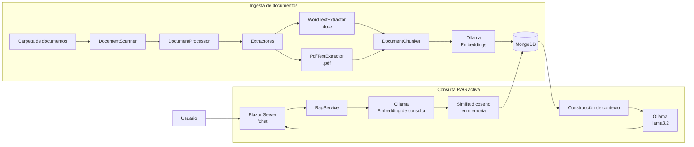
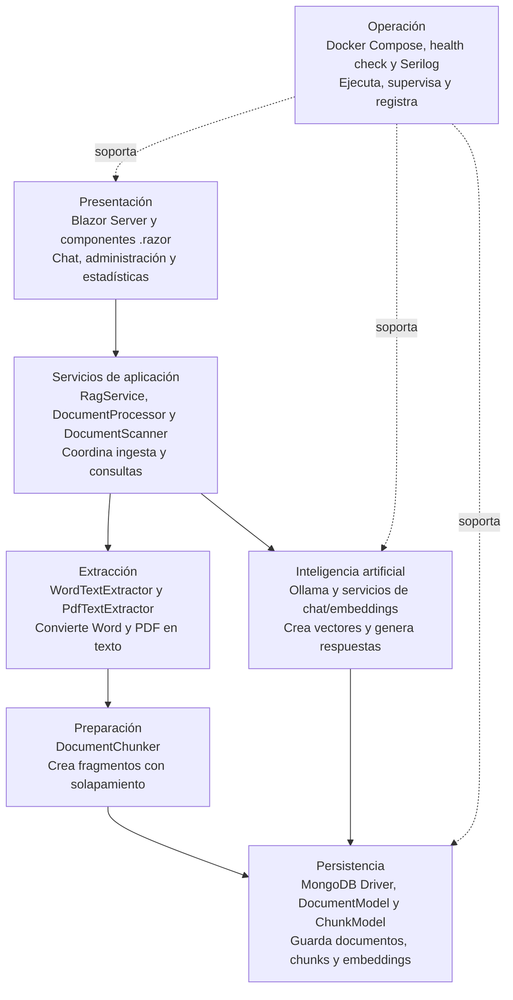
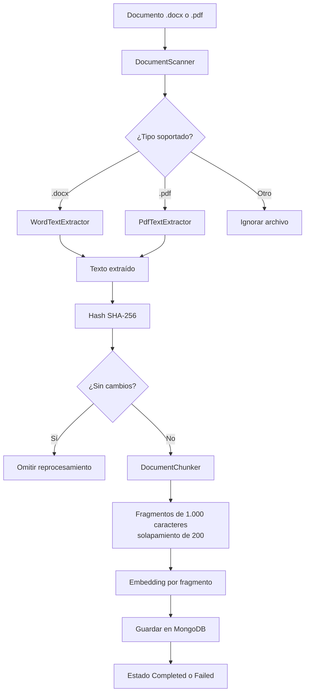
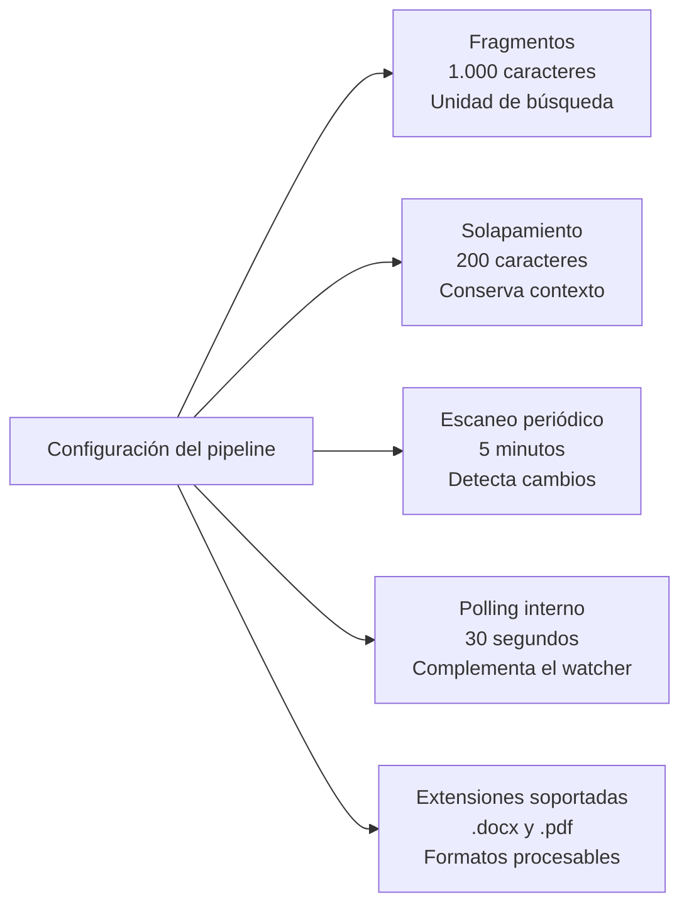
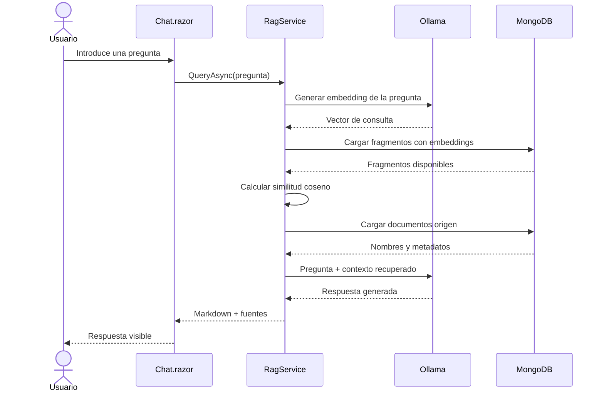
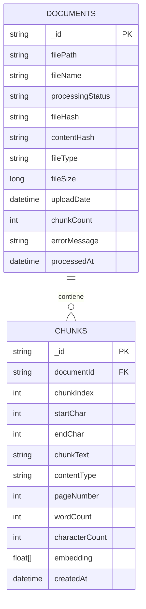
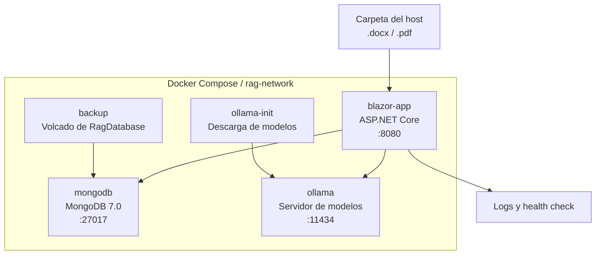
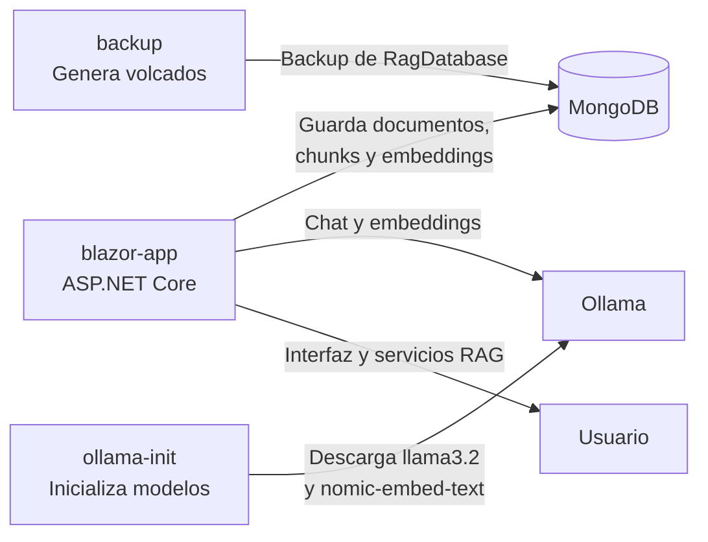
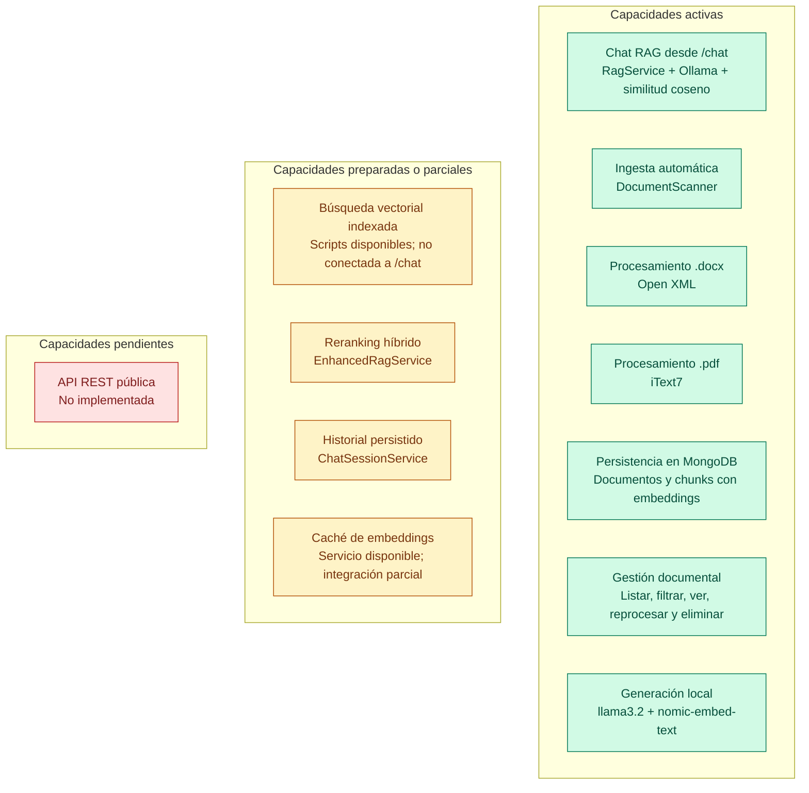

# RAG Blazor Mongo

## Guion técnico para la presentación del proyecto

> Aplicación web que permite consultar documentación corporativa mediante **Retrieval-Augmented Generation (RAG)**. El sistema convierte documentos `.docx` y `.pdf` en fragmentos vectorizados, recupera los fragmentos más relevantes para cada pregunta y genera una respuesta contextualizada con un modelo de lenguaje local.

---

## 1. Resumen ejecutivo

El proyecto resuelve el problema de buscar información en documentación extensa de forma manual.

En lugar de enviar una pregunta directamente a un modelo de lenguaje, la aplicación:

1. Procesa la documentación disponible.
2. Extrae y divide el contenido en fragmentos.
3. Genera un embedding para cada fragmento.
4. Guarda los documentos, fragmentos y vectores en MongoDB.
5. Convierte la pregunta del usuario en otro vector.
6. Recupera los fragmentos semánticamente más similares.
7. Envía esos fragmentos como contexto a un modelo local.
8. Presenta una respuesta en lenguaje natural y muestra las fuentes consultadas.

El resultado es un asistente de conocimiento basado en la documentación de la organización, sin necesidad de entrenar un modelo específico con esos documentos.

---

## 2. Problema que aborda

Las organizaciones suelen almacenar procedimientos, manuales y políticas en archivos dispersos. Esto produce varios problemas:

- La búsqueda tradicional depende de palabras exactas.
- El usuario debe abrir varios documentos para comparar información.
- Los documentos largos dificultan localizar el contexto correcto.
- Las respuestas generadas por una IA sin contexto pueden ser imprecisas o inventadas.
- Los documentos pueden cambiar y necesitan reprocesarse sin duplicar información.

### Propuesta de valor

La aplicación combina búsqueda semántica y generación de texto para responder preguntas utilizando únicamente los fragmentos recuperados de la documentación procesada.

---

## 3. Objetivos

### Objetivo principal

Construir un asistente web que permita consultar documentos internos mediante lenguaje natural y obtener respuestas fundamentadas en sus fuentes.

### Objetivos específicos

- Automatizar la detección de documentos nuevos o modificados.
- Admitir archivos Word (`.docx`) y PDF (`.pdf`).
- Extraer texto conservando información estructural cuando está disponible.
- Dividir documentos en fragmentos manejables con solapamiento.
- Generar embeddings usando un modelo local.
- Persistir documentos y fragmentos en MongoDB.
- Recuperar contenido relevante mediante similitud coseno.
- Generar respuestas con un LLM local mediante Ollama.
- Mostrar las fuentes consultadas junto con la respuesta.
- Proporcionar una interfaz para revisar, reprocesar y eliminar documentos.
- Ejecutar el entorno completo mediante Docker Compose.

---

## 4. ¿Qué significa RAG?

**RAG** significa *Retrieval-Augmented Generation*, o generación aumentada mediante recuperación.

El patrón separa el problema en dos fases:

### Recuperación (*Retrieval*)

Se busca en la base de conocimiento el contenido más relacionado con la pregunta. La relación no depende únicamente de palabras coincidentes, sino de la proximidad entre embeddings.

### Generación (*Generation*)

El modelo de lenguaje recibe la pregunta junto con el contexto recuperado y redacta una respuesta basada en ese contexto.

```text
Pregunta del usuario
        │
        ▼
Embedding de la pregunta
        │
        ▼
Recuperación de fragmentos relevantes
        │
        ▼
Contexto + pregunta
        │
        ▼
Modelo de lenguaje local
        │
        ▼
Respuesta con fuentes
```

### Ventajas del enfoque

- La documentación se puede actualizar sin reentrenar el LLM.
- El sistema puede utilizar documentos propios de cada organización.
- La respuesta se puede relacionar con fuentes concretas.
- Ollama permite ejecutar los modelos localmente, sin enviar el contenido a un proveedor externo.

---

## 5. Arquitectura general



### Capas principales



---

## 6. Stack tecnológico

### Aplicación

- **C# y ASP.NET Core**.
- **.NET 10**, según el `TargetFramework` del proyecto.
- **Blazor Server** con componentes Razor interactivos.
- **Semantic Kernel** como abstracción para chat y embeddings.
- **Markdig** para renderizar las respuestas en Markdown.

### Procesamiento de documentos

- **DocumentFormat.OpenXml 3.1.0** para archivos `.docx`.
- **iText7 8.0.5** para archivos `.pdf`.
- Extractores desacoplados mediante la interfaz `ITextExtractor`.
- División de texto en fragmentos de aproximadamente 1.000 caracteres con 200 caracteres de solapamiento.

### Datos y búsqueda

- **MongoDB 7.0** como persistencia de documentos y fragmentos.
- **MongoDB.Driver 2.30.0** para acceso desde C#.
- Vectores almacenados en el campo `Embedding` de cada fragmento.
- Similitud coseno calculada por la ruta activa de consulta.

### Inteligencia artificial

- **Ollama** como servidor local de modelos.
- **`llama3.2`** para generar respuestas.
- **`nomic-embed-text`** para generar embeddings.
- Integración HTTP con los endpoints `/api/chat` y `/api/embeddings` de Ollama.

### Despliegue y operación

- **Docker** y **Docker Compose**.
- Volúmenes persistentes para MongoDB y Ollama.
- Red privada `rag-network` entre contenedores.
- **Serilog** para logs en consola y archivos rotativos.
- Health check HTTP en `/health`.

---

## 7. Pipeline de ingesta

La ingesta transforma los archivos originales en una base de conocimiento consultable.



### Paso a paso

1. `DocumentScanner` revisa las rutas configuradas, por defecto `/app/documents`.
2. El escaneo puede utilizar `FileSystemWatcher` y polling periódico.
3. Se admiten archivos `.docx` y `.pdf`.
4. El extractor correspondiente obtiene el texto del archivo.
5. `DocumentProcessor` calcula un hash SHA-256 para detectar cambios.
6. Si el contenido no cambió y ya fue procesado, se evita trabajo innecesario.
7. `DocumentChunker` divide el texto intentando conservar párrafos, títulos y posiciones.
8. Cada fragmento se envía a `nomic-embed-text`.
9. El vector resultante se guarda junto al fragmento.
10. El documento se marca como `Pending`, `Processing`, `Completed` o `Failed` según el resultado.

### Parámetros actuales



---

## 8. Pipeline de consulta

La ruta actualmente conectada a `/chat` es `RagService`.



### Reglas del prompt

La aplicación solicita al modelo que:

- Responda únicamente con base en el contexto proporcionado.
- Indique claramente cuando la información no está disponible.
- Use pasos numerados cuando la consulta describa un procedimiento.
- Sea clara, concisa y precisa.

### Resultado para el usuario

La interfaz muestra:

- La consulta enviada.
- La respuesta generada.
- Una lista de documentos utilizados como fuente.
- El número de fragmentos consultados por documento.
- El contenido renderizado como Markdown.

---

## 9. Modelo de datos

La base de datos principal es `RagDatabase`.



### Colección `documents`

Representa el archivo original y su estado de procesamiento.

Contiene, entre otros datos:

- Identificador del documento.
- Ruta y nombre del archivo.
- Tipo y tamaño.
- Hash del archivo/contenido.
- Estado de procesamiento.
- Fechas de carga y procesamiento.
- Metadatos como título, autor y número de páginas.
- Número de fragmentos generados.
- Mensaje de error si el procesamiento falla.

### Colección `chunks`

Representa una unidad de contenido que puede recuperarse durante una consulta.

Contiene:

- Referencia al documento padre mediante `DocumentId`.
- Índice del fragmento dentro del documento.
- Texto del fragmento.
- Posición inicial y final en el texto original.
- Página, cuando se puede determinar.
- Tipo de contenido, por ejemplo texto, título o tabla.
- Conteo de palabras y caracteres.
- Vector de embedding.

### Colecciones preparadas

El proyecto también contiene modelos y servicios para:

- `embedding_cache`.
- `chat_sessions`.
- `chat_messages`.

Estas capacidades están preparadas en el código, pero el historial persistido y la caché completa no están conectados a la experiencia activa de `/chat`.

---

## 10. Interfaz de usuario

### `/chat`

Pantalla principal del asistente.

- Entrada de preguntas de hasta 2.000 caracteres.
- `Enter` para enviar.
- `Shift + Enter` para insertar una nueva línea.
- Indicador de carga durante la consulta.
- Respuesta renderizada en Markdown.
- Listado de fuentes consultadas.

### `/documents`

Panel de administración documental.

- Lista paginada de documentos.
- Filtro por nombre, tags y estado.
- Estadísticas de documentos y fragmentos.
- Escaneo manual de la carpeta.
- Reprocesamiento de un documento.
- Visualización de fragmentos.
- Eliminación de documentos y fragmentos relacionados.

### `/statistics`

Dashboard de métricas recopiladas en memoria.

### `/health`

Endpoint utilizado por Docker para comprobar la disponibilidad de la aplicación.

> La aplicación es una interfaz Blazor Server interactiva. En esta versión no expone una API REST pública con controladores o endpoints JSON para las operaciones RAG.

---

## 11. Despliegue con Docker Compose

El entorno principal está compuesto por cinco servicios:





### Persistencia

- `mongo_data`: datos de MongoDB.
- `ollama_data`: modelos descargados de Ollama.
- `documents/`: documentos montados en `/app/documents`.
- `backups/`: copias de seguridad de la base de datos.

### Inicio rápido

```powershell
Copy-Item .env.example .env
docker compose up -d --build
docker compose ps
docker compose logs -f ollama-init
Invoke-WebRequest http://localhost:8080/health
```

Después se puede abrir:

```text
http://localhost:8080/chat
```

### Orden de arranque

1. MongoDB inicia y pasa su health check.
2. Ollama inicia y queda disponible.
3. `ollama-init` descarga los modelos necesarios.
4. La aplicación Blazor inicia cuando Ollama y la inicialización de modelos terminan correctamente.
5. El scanner comienza a revisar la carpeta de documentos.

---

## 12. Observabilidad y operación

La aplicación incorpora mecanismos básicos de operación:

- Health check en `/health`.
- Logs estructurados con Serilog.
- Logs en consola y archivos diarios.
- Retención configurada de hasta 30 archivos de log.
- `CorrelationId` para relacionar solicitudes y eventos.
- Middleware de gestión de errores.
- Middleware de logging de solicitudes.
- Middleware de monitorización de rendimiento.
- Métricas visibles en `/statistics`.
- Health checks en Docker Compose para MongoDB, Ollama y la aplicación.

Comandos útiles:

```powershell
# Estado de los servicios
docker compose ps

# Logs de la aplicación
docker compose logs -f blazor-app

# Logs de Ollama
docker compose logs -f ollama ollama-init

# Modelos disponibles
docker compose exec ollama ollama list

# Colecciones de MongoDB
docker compose exec mongodb mongosh RagDatabase --eval "db.getCollectionNames()"
```

---

## 13. Seguridad y límites actuales

### Decisiones actuales

- Ollama se ejecuta localmente dentro del entorno Docker.
- La aplicación Blazor se ejecuta con un usuario no root dentro del contenedor.
- Los documentos se montan en modo lectura en el contenedor.
- MongoDB y Ollama se comunican mediante una red Docker interna.
- Los datos de MongoDB y los modelos de Ollama se conservan en volúmenes persistentes.

### Aspectos pendientes antes de un entorno multiusuario

- No hay autenticación ni autorización implementadas.
- No existe autorización por documento.
- La ruta `/documents` permite operaciones administrativas desde la interfaz.
- El endpoint `/health` comprueba la disponibilidad del endpoint, pero no valida por sí solo todas las dependencias.
- La ruta activa carga todos los fragmentos y calcula la similitud en memoria.
- No se utiliza todavía `$vectorSearch` de MongoDB en la consulta activa.
- El historial de chat persistido no está conectado a `/chat`.
- La caché de embeddings está preparada, pero no evita todas las llamadas del pipeline activo.
- La aplicación no expone una API REST pública.
- Para producción se necesita un reverse proxy con HTTPS y protección de secretos.

Estas limitaciones deben explicarse durante la presentación para diferenciar la implementación actual de las capacidades preparadas para una evolución posterior.

---

## 14. Funcionalidades activas frente a funcionalidades preparadas



---

## 15. Guion recomendado para una demo

### Escenario

Utilizar uno o varios documentos con procedimientos claros, por ejemplo un manual de incorporación o una política interna.

### Secuencia

1. Mostrar la carpeta `documents/` con los archivos `.docx` y `.pdf`.
2. Iniciar el entorno con Docker Compose.
3. Verificar que `ollama-init` descargó los dos modelos.
4. Abrir `/documents`.
5. Ejecutar **Escanear y actualizar**.
6. Mostrar el cambio de estado del documento hasta `Completado`.
7. Abrir los fragmentos de un documento.
8. Ir a `/chat`.
9. Realizar una pregunta cuya respuesta esté en la documentación.
10. Mostrar la respuesta y las fuentes consultadas.
11. Realizar una pregunta cuya información no esté en los documentos para mostrar el comportamiento controlado.
12. Modificar o reemplazar un documento y ejecutar un reprocesamiento.
13. Mostrar `/statistics` y `/health`.

### Ejemplos de preguntas

- `¿Cuáles son los pasos del procedimiento de incorporación?`
- `¿Qué requisitos se necesitan para completar este proceso?`
- `¿Qué documentos deben conservarse como evidencia?`
- `¿Qué indica la documentación sobre un caso que no aparece en los documentos?`

### Mensaje que conviene destacar

La aplicación no responde desde el conocimiento general del modelo. Primero recupera fragmentos de la documentación y después solicita al modelo que redacte una respuesta basada en ese contexto.

---

## 16. Evolución prevista

### Corto plazo

- Activar una caché de embeddings en el pipeline de ingesta y consulta.
- Incorporar puntuaciones y metadatos más detallados en las fuentes.
- Persistir las preguntas y respuestas de las sesiones.
- Añadir pruebas de integración con MongoDB y Ollama.
- Mejorar la validación de rutas y patrones de documentos.

### Medio plazo

- Sustituir la carga completa de fragmentos por `$vectorSearch` o un índice vectorial equivalente.
- Conectar `EnhancedRagService` y `RagOrchestrator` con la página activa de chat.
- Incorporar búsqueda híbrida por texto y vector.
- Ensamblar fragmentos contiguos para mantener más contexto.
- Añadir autenticación, autorización y permisos por colección o documento.
- Exponer una API HTTP con DTOs, validación y códigos de respuesta estables.

### Producción

- Ejecutar la aplicación detrás de un reverse proxy HTTPS.
- Mantener MongoDB y Ollama en una red no pública.
- Gestionar secretos mediante variables seguras o un gestor de secretos.
- Almacenar backups fuera del host de los contenedores.
- Medir latencia, calidad de recuperación y precisión de las respuestas.
- Evaluar GPU y límites de memoria para Ollama.

---

## 17. Mensajes clave para cerrar la presentación

- El proyecto convierte documentos empresariales en una base de conocimiento consultable.
- RAG permite actualizar la documentación sin reentrenar el modelo de lenguaje.
- La ingesta y la consulta están separadas en pipelines independientes.
- MongoDB conserva tanto los documentos como los fragmentos vectorizados.
- Ollama permite ejecutar chat y embeddings localmente.
- Blazor Server ofrece una interfaz web integrada para usuarios y administradores.
- Docker Compose simplifica la puesta en marcha de toda la solución.
- La implementación actual es funcional y deja una ruta clara hacia búsqueda vectorial indexada, sesiones, caché y seguridad multiusuario.

---

## Referencias del repositorio

- `README.md`: instalación, configuración y operación.
- `docs/Architecture.md`: arquitectura y límites comprobados.
- `docs/API.md`: rutas, contratos internos e integración con Ollama.
- `docker-compose.yml`: definición de servicios y dependencias.
- `BlazorApp/Program.cs`: registro de servicios y pipeline ASP.NET Core.
- `BlazorApp/Services/DocumentProcessor.cs`: pipeline de ingesta.
- `BlazorApp/Services/RagService.cs`: pipeline RAG activo.
- `BlazorApp/Components/Pages/Chat.razor`: interfaz de consulta.
- `BlazorApp/Components/Pages/Admin/Documents.razor`: gestión documental.
