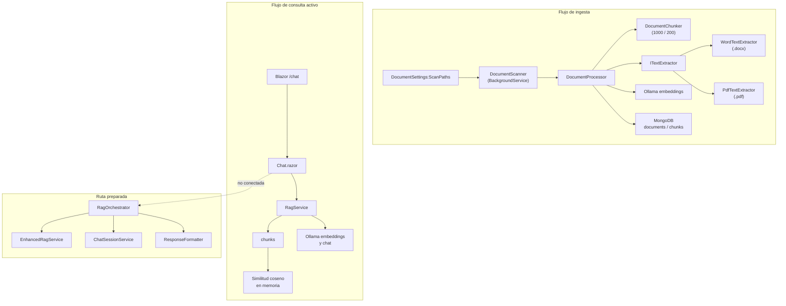

# Arquitectura

## Resumen

El sistema es una aplicación ASP.NET Core Blazor Server sobre .NET 10. La ingesta y la consulta RAG se separan en servicios de aplicación, los datos se almacenan en MongoDB y Ollama proporciona generación de texto y embeddings.

## Capas y responsabilidades

| Capa | Componentes | Responsabilidad |
|---|---|---|
| Presentación | `Components/Pages`, `Chat.razor`, `Documents.razor`, `MarkdownRenderer.razor` | UI interactiva, entrada de consultas, administración y renderizado Markdown. |
| Orquestación | `RagOrchestrator` | Coordina la ruta mejorada, sesiones, procesamiento y resultados unificados. Está registrado en DI, pero no lo usa `/chat`. |
| RAG | `RagService`, `EnhancedRagService`, `ResponseFormatter` | Embeddings de consultas, recuperación, contexto, llamada al LLM y formato de fuentes. |
| Ingesta | `DocumentScanner`, `DocumentProcessor`, `DocumentChunker` | Detecta archivos, calcula hashes, extrae texto, crea chunks y guarda embeddings. |
| Extracción | `ITextExtractor`, `WordTextExtractor`, `PdfTextExtractor` | Convierte Word y PDF a texto estructurado. |
| Persistencia | `IMongoClient`, `IMongoDatabase`, modelos BSON | Acceso a `RagDatabase` y sus colecciones. |
| Integración IA | `OllamaChatService`, `OllamaEmbeddingService` | Adaptadores HTTP para `/api/chat` y `/api/embeddings`. |
| Observabilidad | middleware de errores, solicitudes y rendimiento; Serilog; `/statistics` | Correlación de solicitudes, errores, tiempos y métricas en memoria. |

`Program.cs` registra los servicios como singleton, añade componentes Razor interactivos, health checks y el scanner como servicio hospedado. La aplicación usa `UseErrorHandling`, `UseRequestLogging` y `UsePerformanceMonitoring` antes de mapear componentes y `/health`.

## Flujo de ingesta

1. `DocumentScanner` lee `DocumentSettings:ScanPaths` y busca `.docx` y `.pdf`.
2. El scanner puede usar polling y `FileSystemWatcher`; el procesamiento periódico está configurado a cinco minutos por defecto.
3. `DocumentProcessor` comprueba existencia, extensión y hash SHA-256. Un documento sin cambios puede omitirse.
4. El extractor correspondiente conserva párrafos, títulos, tablas y páginas cuando el formato las proporciona.
5. `DocumentChunker` separa por estructura y genera chunks de 1000 caracteres con 200 de overlap en la implementación actual.
6. Cada chunk recibe un embedding de `OllamaEmbeddingService` y se guarda en `ChunkModel.Embedding`.
7. El documento se guarda en `documents` y sus chunks en `chunks`. Al actualizar un archivo, se reemplazan los chunks asociados.
8. El estado del documento queda como `pending`, `processing`, `completed` o `failed`, con mensaje de error cuando corresponde.

El flujo actual es secuencial. `EmbeddingCacheService` existe con caché en memoria/MongoDB, pero `DocumentProcessor` y la ruta activa de RAG todavía no la consultan para evitar regeneraciones.

## Flujo de consulta activo

`Chat.razor` inyecta `RagService` y mantiene una consulta y una respuesta visibles.

1. El usuario escribe hasta 2000 caracteres y envía con Enter.
2. `RagService` pide a Ollama el embedding de la pregunta.
3. Carga los chunks disponibles desde MongoDB.
4. Calcula similitud coseno en memoria y toma los resultados superiores.
5. Busca los documentos origen y construye el contexto con el nombre del archivo.
6. Llama a Ollama con un prompt que restringe la respuesta al contexto.
7. Añade una lista Markdown de fuentes y `MarkdownRenderer` presenta el resultado.

Esta es la ruta comprobada de `/chat`. No consume un índice vectorial de MongoDB, no usa el historial persistido, no ensambla chunks contiguos y no integra completamente el formato de fuentes detalladas.

## Ruta RAG mejorada disponible

`EnhancedRagService` contiene búsqueda y reranking híbridos, así como un límite aproximado de contexto. `RagOrchestrator` puede combinarlo con:

- `DocumentProcessor` para ingesta.
- `ChatSessionService` para sesiones y mensajes.
- `ResponseFormatter` para Markdown y fuentes.
- Resultados tipados como `QueryResult`, `SessionResult` y `ProcessingStatistics`.

Estos servicios están registrados en inyección de dependencias, pero no forman parte de la llamada de `Chat.razor`. Conectar ambas rutas requiere una decisión explícita sobre sesiones, búsqueda vectorial, caché y contrato de respuesta.

## Modelo de datos

### `documents`

`DocumentModel` conserva el identificador BSON, ruta y nombre de archivo, tipo, tamaño, hashes de archivo/contenido, fechas, estado, error, tags, metadatos y cantidad de chunks.

### `chunks`

`ChunkModel` conserva el identificador del documento origen, índice, posiciones inicial/final, texto, tipo de contenido, conteos, página opcional, metadatos, fecha de creación y el vector `float[]`.

### Sesiones y caché

`ChatSession` y `ChatMessage` modelan sesiones y mensajes para `ChatSessionService`. `EmbeddingCacheService` usa una capa de memoria y otra en MongoDB con expiración e invalidación. Ambos componentes están disponibles, pero el historial no se muestra en `/chat` y la caché no está conectada al pipeline activo.

## MongoDB e índices

Los scripts relevantes son:

- `setup-mongodb-optimized.js`: inicialización principal montada por Docker.
- `setup-mongodb.js`: variante de setup.
- `mongo-schema-migration.js`: migración.
- `verify-mongodb-setup.js`: comprobación de colecciones, validadores e índices.

Hay definiciones para índices de texto, compuestos y vectoriales. La aplicación activa no consume `$vectorSearch`; la existencia de una definición en un script tampoco demuestra que el índice vectorial esté creado en la instancia actual. Verifica los índices con `verify-mongodb-setup.js` antes de atribuir rendimiento vectorial al sistema.

La colección esperada incluye `documents`, `chunks`, `embedding_cache`, `chat_sessions` y `chat_messages`. Los scripts contienen algunos nombres legacy que no coinciden completamente con las propiedades C#, por lo que debe elegirse un esquema canónico antes de una integración externa.

## Configuración y despliegue

### Compose principal

`docker-compose.yml` define:

- `mongodb` con `mongo:7.0`, volumen persistente e inicialización.
- `ollama` con volumen de modelos y puerto 11434.
- `ollama-init` para esperar al servidor y descargar `llama3.2` y `nomic-embed-text`.
- `blazor-app` con build multi-stage, puerto 8080, montaje de documentos y health check.
- `backup` para volcados periódicos de `RagDatabase`.

Los servicios comparten la red `rag-network`. La aplicación usa `mongodb` y `ollama` como nombres DNS internos. El Dockerfile ejecuta la aplicación como usuario no root y expone el puerto 8080.

### Compose simple

`docker-compose-simple.yml` inicia MongoDB, Ollama y Blazor con menos configuración. No incluye la inicialización de modelos, health checks, scanner montado ni servicio de backup del compose principal. Debe tratarse como variante de desarrollo.

### Ejecución local

En una ejecución fuera de Docker, sustituye los nombres de servicio por `localhost` en `ConnectionStrings__MongoDb` y `Ollama__Endpoint`. Los modelos de Ollama deben estar instalados previamente.

## Observabilidad y errores

El pipeline incluye:

- `ErrorHandlingMiddleware` para capturar y registrar errores.
- `RequestLoggingMiddleware` para registrar solicitudes y correlation IDs.
- `PerformanceMiddleware` para tiempos y detección de solicitudes lentas.
- Serilog con consola y archivos diarios en `logs/rag-blazor-.log`, con retención configurada de 30 archivos.
- `/statistics` para métricas en memoria.
- `/health` para la comprobación básica de disponibilidad.

El health check registrado no verifica por sí mismo todas las dependencias. Para diagnosticar el sistema se deben combinar `/health`, `docker compose ps`, logs de `blazor-app`, logs de `mongodb` y logs de `ollama`.

## Límites y decisiones pendientes

La siguiente lista describe límites actuales, no funcionalidades garantizadas:

1. `/chat` usa similitud coseno en memoria en lugar de búsqueda vectorial indexada.
2. El historial de sesiones y el orquestador mejorado no están conectados a la UI activa.
3. La caché de embeddings existe, pero el pipeline activo no la usa para evitar llamadas.
4. El procesamiento de documentos es secuencial y no hay benchmark reproducible de 100 documentos.
5. No hay autenticación, autorización por documento ni validación completa de rutas contra una raíz permitida.
6. El esquema de scripts de MongoDB debe unificarse con los nombres serializados por los modelos C#.
7. El servicio no ofrece una API REST pública; exponer servicios internos requiere una capa HTTP con DTOs, validación y seguridad.

Estas decisiones deben resolverse antes de presentar la aplicación como un servicio multiusuario o como una plataforma de búsqueda vectorial indexada.
